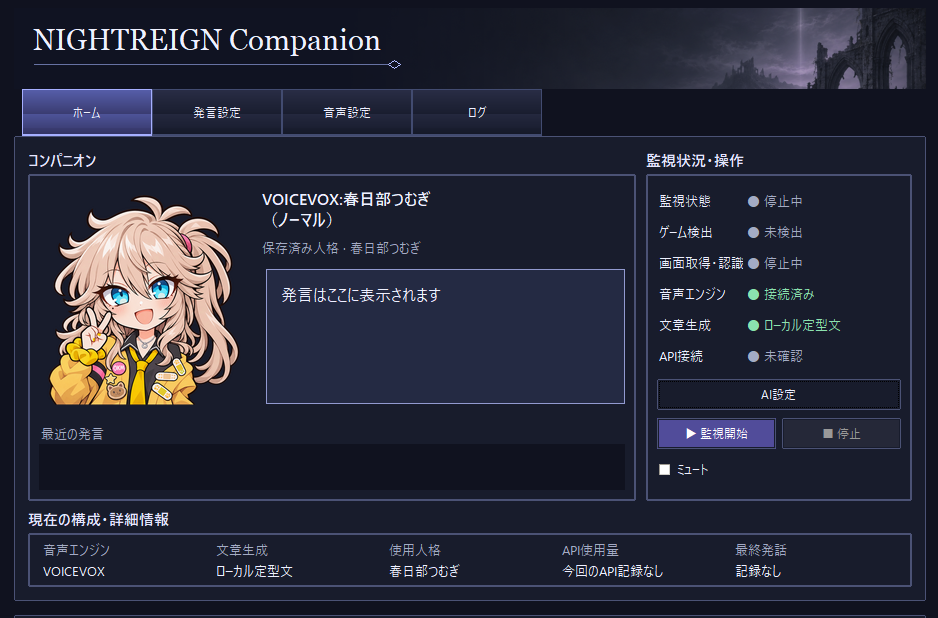

# NIGHTREIGN Companion

ELDEN RING NIGHTREIGNのプレイ画面を監視し、ゲーム中の出来事に合わせて音声と字幕で反応する、非公式のWindows向けコンパニオンです。ゲーム本体は別途必要です。

## はじめ方

1. 配布リポジトリの [Releases](https://github.com/mement-O/nightreign-companion-release/releases) から、Windows x64用の `NightreignCompanion-1.1.0-windows-x64.zip` をダウンロードします。
2. ZIPをすべて展開し、展開先の一番上にある `NightreignCompanion.exe` を開きます。
3. 初回起動時のMicrosoftランタイム利用条件に同意すると、Windows標準音声とローカル定型文で始められます。Python・インストーラー・APIキーは不要です。

Windows 10/11 x64のシステムUCRTと、同梱のMicrosoft Visual C++ v14ランタイムを使用します。ランタイムの権利表記は同梱のライセンス文書をご覧ください。 [Microsoft Visual C++ Runtime 2026の利用条件](https://visualstudio.microsoft.com/license-terms/vs2026-ga-visualcpp-v14-redist-runtime/)

ゲーム状況に応じた通知、探索中の雑談、字幕・キャラクター画像、発言履歴を使えます。VOICEVOX、OpenAI、Geminiは任意です。外部APIは個別のキーが必要で、提供元により利用料金が発生します。画面認識は解像度や表示モードなどの影響を受けます。

## 設定と更新

設定・画像・出撃記録は展開先の `user-data/` に保存されます。正常終了後はフォルダーごと移動できます。削除や引っ越しの前には「バックアップ・復元」でアプリの外に保存してください。APIキーはバックアップ対象外です。

更新はアプリの「アップデートを確認」から行います。ダウンロードと適用の前にそれぞれ確認が表示されます。詳しい操作は [利用ガイド](利用ガイド.md) またはZIP同梱の「利用方法.txt」をご覧ください。

## バージョンと権利表記

初回一般配布版は **1.1.0（Windows x64）** です。主要な変更とファイルの確認情報は各Releaseに記載します。

本ツールはファン制作の非公式ツールです。ゲーム開発元・販売元やVOICEVOX開発元の公認・サポートを受けていません。ゲーム名、キャラクター名および第三者素材に関する権利は各権利者に帰属します。VOICEVOX本体は別途導入してください。VOICEVOX音声を利用する際は、利用したことが分かるクレジットを表記し、各音声ライブラリの規約に従ってください。 [VOICEVOX利用規約](https://voicevox.hiroshiba.jp/term/)

### 素材クレジット

音声設定でVOICEVOX話者を選び、「クレジットをコピー」で表記を取得できます。配信・動画投稿では、実際に使用したすべての話者について、個別規約で指定された場所と書式で表記してください。画面に標準の「VOICEVOX:話者名」が表示される場合も、個別規約で指定表記、投稿先、収益化条件を確認してください。 [VOICEVOX公式の話者別利用規約一覧](https://github.com/VOICEVOX/voicevox_vvm/blob/main/TERMS.txt)

標準立ち絵は、開発者がChatGPTで生成した非公式の二次創作画像です。個人制作・非営利・無償配布の本アプリに、6キャラクターの立ち絵を各5枚同梱します。キャラクターに関する権利は各権利者に帰属し、立ち絵はアプリ独自のライセンスによる再許諾の対象外です。ヘッダー背景も開発者がChatGPTで生成した画像です。

| 標準立ち絵 | 公式利用規約・ガイドライン |
| --- | --- |
| ずんだもん | [東北ずん子・ずんだもんプロジェクトの利用ガイドライン](https://zunko.jp/guideline.html) |
| 四国めたん | [東北ずん子・ずんだもんプロジェクトの利用ガイドライン](https://zunko.jp/guideline.html) |
| 東北きりたん | [東北ずん子・ずんだもんプロジェクトの利用ガイドライン](https://zunko.jp/guideline.html) |
| 春日部つむぎ | [二次創作活動の手引き](https://tsumugi-official.studio.site/rule) |
| 冥鳴ひまり | [冥鳴ひまりの利用規約](https://meimeihimari.wixsite.com/himari/terms-of-use) |
| No.7 | [No.7公式サイトの利用規約](https://voiceseven.com/#j0200) |

